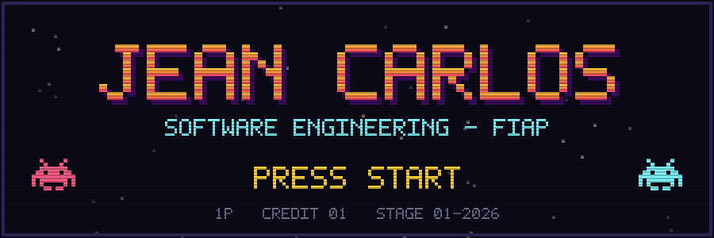

<p align="center">
  
</p>

```
> LOADING PLAYER_01 ...................... OK
> NAME ......... Jean Carlos Rodrigues
> CLASS ........ Software Engineering @ FIAP (2025 - 2028)
> SPEC ......... back-end / data engineering
> LOCATION ..... São Paulo, BR
> LANGUAGES .... pt-BR (nativo) / en (avançado)
> STATUS ....... procurando estágio
```

### `$ whoami`

Estudante de Engenharia de Software na FIAP. Gosto de pegar um problema e levar até o fim:
banco, API, tela e, quando tem dado no meio, o pipeline e o dashboard também.
Hoje meu foco está em **back-end** e **engenharia de dados**.

---

### `[ INVENTORY ]`

<p>
  
  <br>
  
</p>

```
ITEM                 TIPO          USO
java                 linguagem     back-end, POO, projetos FIAP
python               linguagem     dados, automação, Streamlit
javascript / node    linguagem     front, CRUDs, scripts
c++ (arduino)        linguagem     IoT / edge computing
bigquery             banco         análise de dados (GA4)
git                  ferramenta    sempre equipado
```

---

### `[ QUEST LOG ]`

| status | quest | stack | |
|:--:|---|---|---|
| `[x]` | **FIAP Bank (ATM)** — caixa eletrônico em Java com DDD | Java | [repo](https://github.com/jeanmmv/-fiap-ddd-java-checkpoint1-atm) |
| `[x]` | **EnchenteZero** — monitoramento de enchentes com sensores e display LCD | Arduino / C++ | [repo](https://github.com/GlobalSolution-EnchenteZero/enchentezero-arduino) |
| `[x]` | **Sprint 4 Edge** — solução de edge computing da FIAP | C++ | [repo](https://github.com/Sprint4Edge/Sprint4-Edge) |
| `[x]` | **GA4 Analytics** — dashboard do Google Merchandise Store | Python, BigQuery, Streamlit | — |
| `[x]` | **projetoCRUD** — CRUD em JavaScript | JavaScript | [repo](https://github.com/jeanmmv/projetoCRUD) |
| `[x]` | **projetoLoja** — loja front-end | HTML, CSS | [repo](https://github.com/jeanmmv/projetoLoja) |
| `[ ]` | **Ecoa** — motor de inteligência de reuniões (FIAP Challenge 2026) | em andamento | — |

---

### `[ STATS ]`

<p>
  
  
</p>

---

### `[ SAVE POINT ]`

```
> conectar com PLAYER_01?   [Y/n]
```

<p>
  <a href="https://www.linkedin.com/in/jean-carlos-rodrigues-b1b293211/"></a>
  <a href="mailto:jeancarlos12762@gmail.com"></a>
</p>

<sub>`GAME OVER? não, só checkpoint. continue: 1 credit restante.`</sub>
# jeanmmv
# jeanmmv
# jeanmmv
